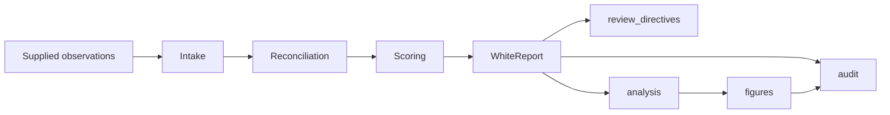

# White Line

White Line is the absence ledger of the four-line governance set. It records
epistemic gaps, ethical restraint, and contemplative negative space without
collapsing them into one claim or asserting a literal invisible causal force.

The executable `assess_absence` returns typed findings with states
`NAMED`, `UNRESOLVED`, `WITHHELD`, or `NOT_RECORDED`. It is not a detector of
hidden causes, a completeness score, a moral authority, or a substitute for
consent and security review.

Assessment is staged: untrusted input is set aside with intake notes rather
than crashing or vanishing, conflicting observations resolve toward the more
cautious state, and dated namings decay to `UNRESOLVED` past each record's
review horizon. A retained observation with a non-ISO `observed_on` records
`UNDATED_OBJECT`: the observation remains visible while its date stays outside
decay accounting. Each report records its review date, registry digest, and
typed intake events so a later review can reconstruct what happened. A
structural invariant battery (`all_ledger_checks`) guards the registry's
shape; `invariant_defect_battery` runs that battery over a registry carrying
exactly the defect each check guards against, and refuses to return unless the
targeted check rejected it, so detection is a shipped call rather than a claim.
`registry_manifest` provides an order-independent digest for change
review. The bounded `review_directives` protocol names follow-up without
producing an approval or safety verdict. See
[docs/architecture.md](docs/architecture.md),
[docs/review_protocol.md](docs/review_protocol.md), and the release
[claim boundaries](docs/claim_boundaries.md).

The witness layer makes one report transportable without changing what it may
claim. `report_facets` factors each finding's single caution-ordered state
into the three questions it compresses — epistemic settlement, disclosure
stance, and temporal status — with `project_facets` proven to recover the
shipped state from the facets, decay included. `return_contracts` reads each
review horizon forward as an obligation: a trigger, a due date proven at the
decay boundary, the artifact class that would count as a return, and an
acceptance condition under which an honest answer may remain unresolved and a
withholding is confirmed rather than disclosed. `report_envelope` wraps the
complete report in the cross-instrument envelope (`line.report-envelope/1.0`)
— a digest pointer to `canonical_report` plus the instrument's non-claims —
so one line's report can be archived beside its siblings' without ranking,
merging, or reinterpreting any of them. Reconciliation likewise preserves
what it resolves: a conflict's displaced state stays typed on the intake
event while the cautious resolution stands.

The pure `white_line.analysis` module makes that contract inspectable without
changing it: `decay_timeline` and `decay_transition_offsets` sweep review dates
to show how dated namings migrate to `UNRESOLVED` past their horizons,
`reconciliation_matrix` tabulates every ordered-pair conflict resolution,
`expiry_horizon` lists current dated namings nearest their review boundary,
and `events_tally` / `coverage_matrix` summarize one report's intake events
and kind-by-state distribution. These views back five of the generated figures
and the manuscript's distributional-views section; none of them is a
completeness, diligence, or negligence score. `expiry_horizon` in particular
returns a refresh schedule for supplied observations and deliberately omits two
classes of naming — one that cannot be dated, and one that has already decayed
— which the refresh-queue figure draws as labelled bands rather than dropping.

White Line is standalone and lives in its own repository. Its companions in the
four-line set each have one too: [Red Line](https://github.com/docxology/red_line)
is the personal security boundary, [Black
Line](https://github.com/docxology/black_line) describes strong practice, and
[Golden Line](https://github.com/docxology/golden_line) describes aspiration. A
fifth work, [line_set](https://github.com/docxology/line_set), is a thin reader
that declares the set and carries its shared framing. White Line does not copy
their prose, registries, or implementation modules, and imports none of them —
those links are orientation, not dependencies.



The diagram is a data-flow map, not a claim that observations are complete,
true, safe, authorized, or attributable to any person or cause.

## Quick start

Everything here runs from a fresh clone of this repository alone. `output/` is
generated and git-ignored, so build the figures before the checks that read
them; the test suite also rebuilds them itself if they are absent.

```bash
uv run python scripts/check_registry.py
uv run python scripts/build_figures.py
uv run pytest tests/ --cov=src --cov-branch --cov-report=term-missing
uv run python scripts/audit_project.py --report
```

`scripts/build_figures.py` needs `rsvg-convert` from librsvg on `PATH`; that is
a system rasterizer, not a Python dependency, and the build says so plainly if
it is missing.

For a publication bundle you need one tool that is not in this repository: the
`docxology/template` render engine. Clone or locate it anywhere, link this
checkout in as its `projects/working/white_line`, render with the qualified
project name `working/white_line`, then run `uv run python
scripts/audit_project.py --write-manifest --report` back here. The
path-independent commands are in
[docs/development.md](docs/development.md), and
[STANDALONE.md](STANDALONE.md) states what a separated copy can and cannot do.
A passing audit means the local source and rendered bundle agree structurally;
it does not verify the truth of observations.

Agent-facing guidance lives in [AGENTS.md](AGENTS.md) (working contract and
invariants) and the local skill at
[.agents/skills/white-line/SKILL.md](.agents/skills/white-line/SKILL.md)
(operational walkthrough with a worked example and gotchas).
