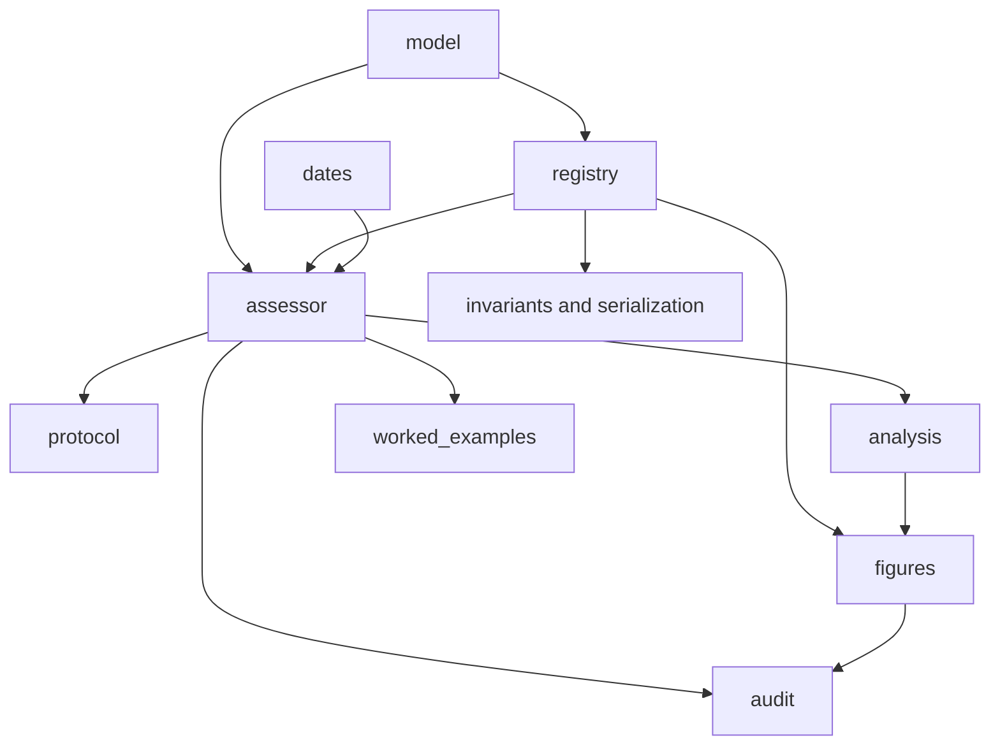

# `white_line` package

The package converts supplied observations into a `WhiteReport` and exposes
bounded follow-up, descriptive analysis, figure building, and artifact audit.
Read [`__init__.py`](__init__.py) for supported imports and
[`assessor.py`](assessor.py) for the core path.

`analysis` only summarizes the established contract; it does not assign
states. `figures` turns declared plates into artifacts, while `audit` checks
structural agreement. None interprets people, motives, safety, legality,
permission, or hidden causes.

Run `uv run pytest -q` from the project root. Next read
[AGENTS.md](AGENTS.md), [model/README.md](model/README.md), and
[figures/README.md](figures/README.md); repository orientation is at
[../../README.md](../../README.md).

Project root: [AGENTS.md](../../AGENTS.md) and [README.md](../../README.md).
