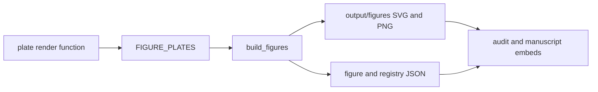

# Generated figure package

This package turns registered plate functions into SVG/PNG pairs and registry
metadata under `output/figures/`. Start with [`plates/__init__.py`](plates/__init__.py)
to see the plate registry, then [`build.py`](build.py) for artifact writing.

The flow produces deterministic artifact structure; it does not validate an
observation or make a completeness, safety, or causal claim.

Run `uv run python scripts/build_figures.py` and `uv run pytest
tests/test_figures.py -q`. Read [AGENTS.md](AGENTS.md),
[plates/README.md](plates/README.md), and [../../../README.md](../../../README.md).

Project root: [AGENTS.md](../../../AGENTS.md) and [README.md](../../../README.md).
